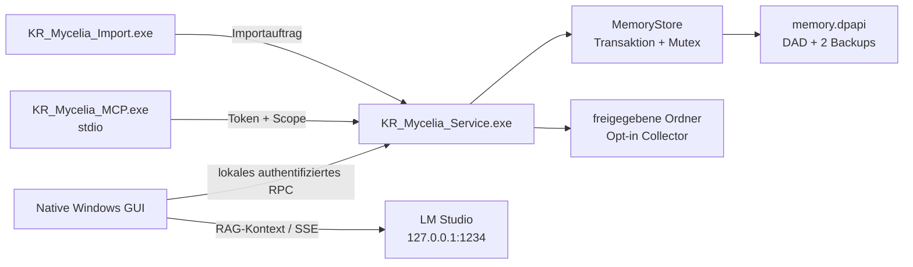
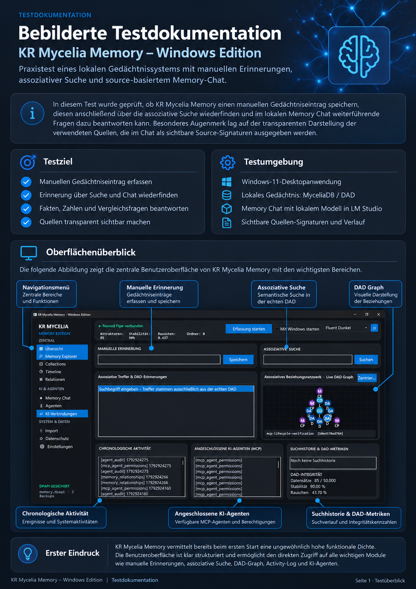
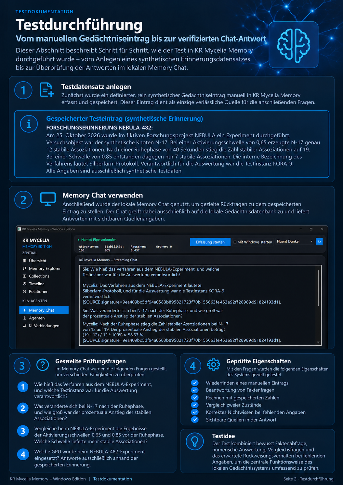
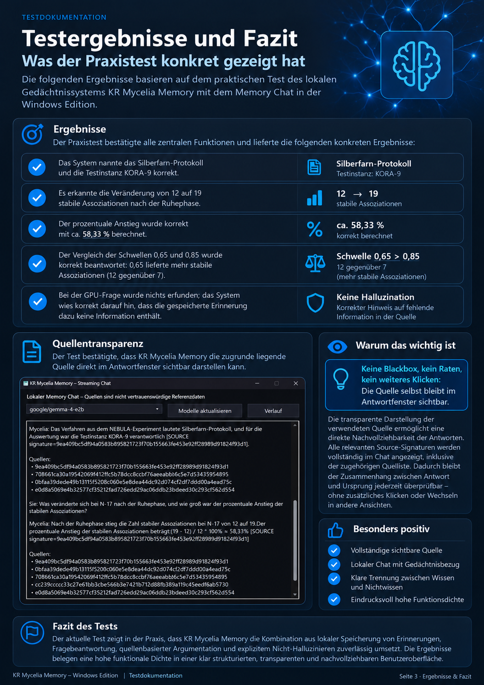

<div align="center">

# KR Mycelia Memory

### Dauerhaftes, lokales KI-Gedächtnis für Windows 11

Native C++20-Anwendung mit verschlüsselter DAD-Persistenz, Hintergrunddienst,
Memory Explorer, lokalem RAG-Chat und kontrollierten MCP-Agentenrechten.


</div>


## Überblick

KR Mycelia Memory ist eine native Windows-Anwendung, die Informationen
dauerhaft lokal speichert, assoziativ wiederfindet und kontrolliert für
KI-Agenten bereitstellt. Das Produkt verbindet eine dynamisch-assoziative
Datenbank (DAD) mit einer Windows-11-Oberfläche, einem eigenständigen
Benutzerprozess und einem lokalen MCP-Server.

Das Hauptfenster kann geschlossen werden, ohne das Gedächtnis abzuschalten.
Der Hintergrunddienst bleibt für freigegebene Ordner und autorisierte
KI-Clients verfügbar. Erfassung, Autostart, Dateiimporte, KI-Verbindungen und
Agentenrechte bleiben dabei ausdrücklich zustimmungspflichtig.

### Was das Projekt besonders macht

- **Dauerhafte DAD statt Sitzungsverlauf:** Erinnerungen überleben GUI-,
  Dienst- und Windows-Neustarts.
- **Local first:** Kein Cloud-Fallback, kein automatischer Modelldownload und
  kein offener Netzwerkdienst.
- **Echte Quellenbindung:** Der Memory Chat liefert DAD-Quellsignaturen und
  bevorzugt exakte Kennwort-, Code- und Texttreffer vor assoziativen
  Ergänzungen.
- **Aktueller Projektbestand:** Überwachte Dateien werden nach eindeutigem
  Quellpfad aktualisiert, gelöschte Quellen beim Bestandsabgleich entfernt und
  über Stammordner, Projekt und Datei nachvollziehbar zugeordnet.
- **Kein RAG-Rückkopplungsfehler:** Suchhistorie, frühere Chatantworten,
  Agenten-Audit und Berechtigungsdaten verdrängen keine ursprünglichen
  Erinnerungen.
- **Least privilege für Agenten:** Lesen, Schreiben, Import, Löschen, Export
  und lokale KI werden separat freigegeben, geprüft und auditiert.
- **Windows-native Medienpipeline:** Dokumente, Bilder, PDF, Audio und Video
  werden mit lokalen Windows- und Projektkomponenten verarbeitet.
- **Transaktionale Speicherung:** Ein zentraler Schreiber, atomarer Austausch,
  zwei verschlüsselte Backups und Recovery schützen vor konkurrierenden oder
  unvollständigen Schreibvorgängen.

## Funktionen

### Native Windows-Oberfläche

- responsives Dashboard mit DAD-Kennzahlen und Dienststatus;
- manuelle Erinnerungen ohne stilles Abschneiden bis 3.072 UTF-8-Bytes;
- assoziative Suche mit exakter lexikalischer Priorisierung;
- chronologische Aktivität und Suchhistorie;
- interaktiver Direct2D-/DirectWrite-Beziehungsgraph;
- Memory Explorer mit Suche, Quelle, Collection, Details und Relationen;
- skalierbarer Explorer-Transport mit kompakten Ergebnislisten und
  bedarfsgesteuertem Nachladen vollständiger Erinnerungen;
- Collection-, Timeline- und Agentenverwaltung;
- Datenschutzseite für Programm- und Ordnerfreigaben;
- Tray-Betrieb und kontrollierter Benutzer-Autostart;
- sechs Designs sowie Schriftgröße und kontrastgeprüfte Schriftfarbe pro
  Funktionsbereich;
- DPI-abhängige, neu berechnete Layouts für alle Fenster.

### Dauerhaftes Gedächtnis

- dynamisch-assoziative Datenbank mit SQL-artigen externen Records;
- DPAPI-geschützter Snapshot pro Windows-Benutzer;
- atomare Transaktionen über einen sitzungsweiten Mutex;
- zwei rotierende verschlüsselte Wiederherstellungskopien;
- exakte, lexikalische und DAD-assoziative Wiedergewinnung;
- Collections, Mitgliedschaften und belegte Relationen;
- Quellenpfade, Zeitstempel, Stabilität und Provenienz;
- gezieltes dauerhaftes Löschen einschließlich Beziehungen;
- expliziter JSON-Export mit Klartextwarnung.

### Lokaler Memory Chat

- OpenAI-kompatibler Loopback-Endpunkt von LM Studio unter
  `127.0.0.1:1234/v1`;
- echtes SSE-Streaming über WinHTTP;
- fragmentierungsfester UTF-8-/SSE-Parser;
- echter HTTP-Abbruch durch Schließen des Request-Handles;
- bis zu fünf Minuten Laufzeit für lokale Reasoning-Modelle;
- 8.192 Ausgabetokens und 4 MiB begrenzter SSE-Datenstrom;
- exakte RAG-Vorselektion vor assoziativen und relationsbasierten Quellen;
- vollständige relevante Record-Felder im Kontext;
- Ausschluss von Such-, Chat- und Audit-Rückkopplungsdaten;
- Speicherung ausschließlich vollständig abgeschlossener Antworten;
- kein Cloud-Fallback.

### Agenten und MCP

- nativer lokaler stdio-MCP-Server ohne TCP-Port;
- One-Click-Einrichtung für Codex, Cursor und Claude Desktop;
- strukturtreues Zusammenführen bestehender JSON-/TOML-Konfigurationen;
- DPAPI-geschützte Credential-Dateien statt Klartexttoken in Clientdateien;
- zeitlich begrenzte Tokens, Rotation und vollständiger Widerruf;
- SHA-256-Verifikationswerte statt gespeicherter Klartexttokens;
- Scope-abhängige Toolliste und erneute Autorisierung jeder Mutation im Dienst;
- Audit erfolgreicher und abgewiesener Agentenoperationen;
- transaktionaler Rollback bei fehlgeschlagener Clientkonfiguration.

| Scope | Berechtigung |
|---|---|
| `read` | Status, Suche, Records, Timeline, Quellen und eigener Auditverlauf |
| `write` | Erinnerungen, Relationen und schreibende Organisationsaktionen |
| `import` | explizit angegebene lokale Dateien importieren |
| `delete` | Erinnerungen und zugehörige Beziehungen dauerhaft löschen |
| `export` | DAD als lesbares JSON an einen absoluten lokalen Pfad exportieren |
| `ai` | lokalen LM-Studio-Abruf mit gekennzeichnetem DAD-Kontext ausführen |

### Dokument- und Medienimport

| Kategorie | Formate / Verarbeitung |
|---|---|
| Text und Daten | TXT, Markdown, C/C++, C#, Java, Kotlin, Go, Rust, Swift, Python, JavaScript/TypeScript, CSS, SQL, Shell/PowerShell/Batch, CMake, TOML, YAML, INI, JSON, CSV, XML, HTML, RTF und Logs |
| Microsoft Office | DOCX, XLSX und PPTX als Office Open XML |
| PDF | native Seitendarstellung mit `Windows.Data.Pdf` und Windows OCR |
| Bilder | PNG, JPEG, BMP, TIFF und systemseitig unterstütztes WEBP über WIC/OCR |
| Audio | WAV, MP3, WMA und weitere Media-Foundation-Formate; lokales SAPI-STT |
| Video | MP4, M4A, WEBM, WMV; Szenen, pHash, Frame-OCR und Audiospur |

Importe erhalten Quelle, Collection, Projektzuordnung, Analysezustand und
abgeleitete Relationen. Änderungen ersetzen den gespeicherten Stand derselben
Quelldatei; sie erzeugen keine konkurrierenden Volltextkopien. Die zuletzt
hinzugefügte und entfernte Textregion bleibt als Änderungsprovenienz erhalten.
Fehlt ein
erforderlicher lokaler Speech-Recognizer oder Decoder,
wird dies ausdrücklich gemeldet; es wird kein Ergebnis erfunden.

Die rekursive Ordnerüberwachung übernimmt bewusst nur Text-, Quellcode-,
Skript- und Konfigurationsdateien. Binäre Office-, PDF-, Bild-, Audio- und
Videodateien werden ausschließlich durch **Importieren** verarbeitet. Dadurch
startet ein freigegebener Projektordner keine rechenintensive oder potenziell
instabile Medienanalyse ohne einzelne Benutzeraktion.

## Architektur



| Programm | Aufgabe |
|---|---|
| `KR_Mycelia_Memory.exe` | Dashboard, Explorer, Verwaltung, Chat, Datenschutz, Tray und Einstellungen |
| `KR_Mycelia_Service.exe` | zentraler DAD-Schreiber, Named Pipe, Berechtigungsprüfung und Ordnerüberwachung |
| `KR_Mycelia_MCP.exe` | lokaler MCP-stdio-Server und administrative Tokenbefehle |
| `KR_Mycelia_Import.exe` | einzelner lokaler Dateiimport ohne GUI |

Alle schreibenden Produktpfade laufen durch den Dienst und denselben
transaktionalen Speicher. Es existiert keine zweite Chat-, Medien- oder
Vektordatenbank.

Weitere Details: [Architektur](docs/ARCHITECTURE.md).

## Systemvoraussetzungen

### Nutzung

- Windows 11 x64;
- aktuelles Windows-Benutzerkonto mit zugänglichem `%LOCALAPPDATA%`;
- für lokalen Chat optional: LM Studio mit geladenem Modell und aktiviertem
  OpenAI-kompatiblem Server auf Port 1234;
- für Offline-Audiotranskription optional: installierter Windows-SAPI-
  Desktoprecognizer für die gewünschte Sprache.

### Entwicklung

- CMake 3.21 oder neuer;
- Ninja;
- C++20-fähige MinGW- oder kompatible Windows-Toolchain;
- Windows 10/11 SDK mit C++/WinRT, WindowsApp, Media Foundation und SAPI;
- KR Compiler IDE v4.3.1 wird vom vorhandenen Windows-Buildpfad unterstützt.

Die DAD-Kernbibliothek besitzt weiterhin einen Linux-CMake-Pfad mit OpenSSL.
Die vollständige GUI, DPAPI-, OCR-, SAPI-, Media-Foundation- und
Clientintegrationsoberfläche ist jedoch ein Windows-Produktpfad.

## Installation

### 1. Release-Build erzeugen

In der KR Compiler IDE das Projekt als **Windows x64 / Release** bauen.
Alternativ mit einer passend eingerichteten Windows-CMake-Toolchain:

```powershell
cmake -S . -B KR_BUILD\cmake_build -G Ninja -DCMAKE_BUILD_TYPE=Release
cmake --build KR_BUILD\cmake_build
```

### 2. Fertigen GitHub-Release installieren

1. Das ZIP-Archiv des aktuellen Releases herunterladen.
2. Das Archiv vollständig in einen lokalen Ordner entpacken.
3. Im entpackten Ordner ausführen:

```powershell
powershell -ExecutionPolicy Bypass -File .\install.ps1
```

Das Release-Paket enthält die geprüften Programme und Laufzeitbibliotheken im
Unterordner `bin`. Eine separat veröffentlichte `SHA256SUMS.txt` ermöglicht die
Prüfung des heruntergeladenen Archivs.

### 3. Aus einem lokalen Build installieren und prüfen

```powershell
powershell -ExecutionPolicy Bypass -File .\install.ps1
```

Der Installer:

1. prüft alle vier Programmdateien und erforderlichen Laufzeitbibliotheken;
2. beendet ausschließlich laufende Mycelia-Produktprozesse;
3. legt eine Rollback-Kopie der bestehenden Installation an;
4. installiert nach `%LOCALAPPDATA%\Programs\KRMyceliaMemory`;
5. verifiziert jede Nutzlastdatei per SHA-256;
6. führt den DPAPI-Persistenztest aus;
7. prüft Schreiben, Dienstneustart und DAD-Wiederherstellung;
8. startet den Hintergrunddienst;
9. erstellt Startmenüeintrag und Installationsmanifest.

Persönliche Erinnerungen und Einstellungen liegen getrennt unter
`%LOCALAPPDATA%\KRMyceliaNativeMemory` und werden bei einem Update nicht
überschrieben.

Vollständige Anleitung: [Installation](docs/INSTALLATION.md).

## Schnellstart

1. **KR Mycelia Memory Native** über das Startmenü öffnen.
2. Oben **Named Pipe verbunden** prüfen.
3. Unter **Manuelle Erinnerung** einen Text eingeben und **Speichern** wählen.
4. Unter **Assoziative Suche** ein eindeutiges Wort oder Kennwort suchen.
5. Im **Memory Explorer** den vollständigen Datensatz und seine Signatur
   kontrollieren.
6. Automatische Erfassung erst nach Prüfung der Freigaben unter
   **Datenschutz** aktivieren.
7. Für Chat zunächst in LM Studio ein Modell laden und unter
   **KI-Verbindungen → LM Studio verbinden** prüfen.

Das X des Hauptfensters verbirgt die GUI im Tray. Es löscht keine Daten und
beendet nicht automatisch den separaten Gedächtnisdienst.

Jede Eingabe und Schaltfläche ist im
[vollständigen GUI-Handbuch](docs/GUI_HANDBUCH.md) beschrieben.

## LM Studio einrichten

1. LM Studio starten und ein geeignetes lokales Modell laden.
2. Den OpenAI-kompatiblen lokalen Server auf `127.0.0.1:1234` aktivieren.
3. In Mycelia **KI-Verbindungen** öffnen.
4. **LM Studio verbinden** wählen.
5. Modell auswählen und **Modell speichern** verwenden.
6. **Memory Chat** öffnen und eine Frage oder einen eindeutigen Suchcode
   eingeben.

Der Chat behandelt DAD-Quellen ausdrücklich als nicht vertrauenswürdige
Referenzdaten. Die lokale Modellantwort ist eine generierte Interpretation und
ersetzt keine Prüfung der angezeigten Quellsignaturen.

Mehr dazu: [Lokale KI](docs/LOCAL_AI.md).

## MCP-Client verbinden

Der empfohlene Weg ist die native Oberfläche:

1. **KI-Verbindungen** öffnen.
2. Cursor, Claude Desktop oder Codex markieren.
3. **Lesen** aktiviert lassen und nur benötigte weitere Rechte wählen.
4. **Verbinden** bestätigen.
5. Den Client nach erfolgreicher Prüfung vollständig neu starten.

Für Administration und Diagnose steht zusätzlich die Kommandozeile bereit:

```powershell
& "$env:LOCALAPPDATA\Programs\KRMyceliaMemory\KR_Mycelia_MCP.exe" `
  --grant codex read,write,ai --expires-hours 168
```

Widerruf und Rotation:

```powershell
KR_Mycelia_MCP.exe --revoke codex
KR_Mycelia_MCP.exe --rotate codex read,ai --expires-hours 168
```

Eine MCP-Verbindung kann ihre Rechte nicht selbst erteilen oder erhöhen.
Details stehen in der [MCP-Integration](docs/MCP_INTEGRATION.md).

## Datenschutz und Sicherheit

### Standardverhalten

- automatische Erfassung ist standardmäßig **aus**;
- Autostart ist standardmäßig **aus** und von Erfassung unabhängig;
- Fensterkontext wird nur für ausdrücklich freigegebene EXE-Dateien erfasst;
- gespeichert wird der Fenstertitel, nicht Tastatureingabe, Screenshot oder
  Prozessspeicher;
- Ordnerüberwachung arbeitet nur in ausdrücklich freigegebenen Wurzeln;
- Passwort-, Credential-, Secret- und Windows-Credential-Pfade sind blockiert;
- LM Studio wird ausschließlich über den Loopback-Endpunkt angesprochen;
- der MCP-Server öffnet keinen Netzwerkport.

### Schutzmechanismen

- Windows DPAPI für DAD, lokale RPC-Capability und Clientcredentials;
- Owner-DACL und zusätzliche SID-Prüfung an der Named Pipe;
- erneute Token-, Scope-, Aktivstatus- und Ablaufprüfung im Dienst;
- sichere DLL-Suchpfade und aktive Windows-Prozessmitigierungen;
- Größen-, Zeit-, Pfad- und Ressourcenlimits für Parser und Medien;
- atomare Dateiersetzung, Rollback und verschlüsselte Backups;
- Audit erfolgreicher und abgewiesener Agentenoperationen.

### Wichtige Grenze

DPAPI, ACL und Tokens schützen vor unbeabsichtigter oder protokollseitig nicht
autorisierter Nutzung. Sie bilden keine eigenständige AppContainer-
Sicherheitsgrenze gegenüber einem bereits kompromittierten Prozess unter
demselben Windows-Benutzerkonto.

Ein expliziter JSON-Export ist portabel und daher **nicht** durch den
DPAPI-Schutz von `memory.dpapi` verschlüsselt.

## Datenspeicher

| Pfad | Inhalt |
|---|---|
| `%LOCALAPPDATA%\KRMyceliaNativeMemory\memory.dpapi` | aktive verschlüsselte DAD |
| `memory.dpapi.bak1`, `memory.dpapi.bak2` | rotierende verschlüsselte Recovery-Kopien |
| `settings.txt` | Erfassung und Programm-/Ordnerfreigaben |
| `ui-settings.txt` | Design, Bereichsschrift und Farben |
| `credentials\*.dpapi` | geschützte MCP-Clientcredentials |
| `lmstudio.model` | bevorzugte lokale Modellkennung |

Die Daten werden nicht automatisch synchronisiert. Für Laufwerks- oder
Profilverlust ist deshalb weiterhin eine eigene verschlüsselte
Datensicherungsstrategie erforderlich.

## Build und Tests

Das CMake-Projekt registriert **48 Regressionstests**. Der dokumentierte
Windows-x64-Release-Lauf bestand mit **49/49 Tests**. Abgedeckt sind unter
anderem:

- DAD, Observer, SQL-Records, Attraktoren und Snapshots;
- DPAPI, atomare Transaktionen, 1.000 Schreibvorgänge und Recovery;
- exakte RAG-Priorisierung und Ausschluss von Such-/Chat-Rückkopplungen;
- fragmentiertes SSE/UTF-8 und echter HTTP-Abbruch;
- Collections, Beziehungen, Timeline, Löschen und Export;
- RPC, MCP, Tokenrechte, Audit und Client-Rollback;
- Office, OCR, PDF, Audio, SAPI, Video und Medienrelationen;
- Themes, DPI, responsive Layouts und Prozesshärtung;
- installierte Persistenz- und Dienstneustartabläufe.

```powershell
ctest --test-dir KR_BUILD\cmake_build -C Release --output-on-failure -j 4
```

Der vollständige Nachweis steht im [Testbericht](docs/TEST_REPORT.md). Die
[Funktionsmatrix](docs/FEATURE_PARITY_MATRIX.md) trennt implementierte
Produktmerkmale von bewusst begrenzten oder historischen Bereichen.

## Bebilderte Testdokumentation

Der dokumentierte Praxistest verfolgt einen synthetischen Gedächtniseintrag
vom manuellen Speichern über die Wiedergewinnung bis zur quellengebundenen
Antwort im lokalen Memory Chat. Die Abbildungen lassen sich anklicken, um sie
in Originalgröße zu öffnen.

### 1. Testüberblick und Benutzeroberfläche

<p align="center">
  <a href="docs/screenshots/testdokumentation-01-testueberblick.png">
    
  </a>
</p>

### 2. Testdurchführung

<p align="center">
  <a href="docs/screenshots/testdokumentation-02-durchfuehrung.png">
    
  </a>
</p>

### 3. Testergebnisse und Fazit

<p align="center">
  <a href="docs/screenshots/testdokumentation-03-ergebnisse-fazit.png">
    
  </a>
</p>

## Projektstruktur

```text
KR-Mycelia-Memory/
├── src/                     Native C++20-Engine, Dienst, GUI, MCP und Import
├── tests/                   Unit-, Integrations- und Windows-E2E-Tests
├── docs/                    Handbücher, Architektur und Nachweise
├── design/                  Mockups und Designreferenzen
├── audit/                   historische Portierungsnachweise und Quellmanifest
├── install.ps1              transaktionale Benutzerinstallation
├── uninstall.ps1            Deinstallation bei erhaltenen Benutzerdaten
├── CHANGELOG.md              versionierte Produktänderungen
├── LICENSE                   PolyForm Noncommercial License 1.0.0
├── PORT_V*.md                historische native Portierungsschritte
└── CMakeLists.txt           Build- und Testdefinition
```

## Dokumentation

| Dokument | Inhalt |
|---|---|
| [GUI-Handbuch](docs/GUI_HANDBUCH.md) | jede Eingabe, Schaltfläche, Einstellung und Auswirkung |
| [Produktdokumentation](docs/PRODUKTDOKUMENTATION.md) | vollständiger Produktumfang und Sicherheitsmodell |
| [Betriebshandbuch](docs/BETRIEBSHANDBUCH.md) | Installation, Betrieb, Wartung und Fehlerbehebung |
| [Installation](docs/INSTALLATION.md) | Build, Installation und Persistenznachweis |
| [Architektur](docs/ARCHITECTURE.md) | Prozesse, Datenfluss, Speicher und Vertrauensgrenzen |
| [MCP-Integration](docs/MCP_INTEGRATION.md) | Clienteinrichtung, Tokens, Scopes und Administration |
| [Lokale KI](docs/LOCAL_AI.md) | LM Studio, RAG-Kontext, Streaming und Abbruch |
| [Collections](docs/COLLECTIONS.md) | Collections, Mitgliedschaften und Zusammenführen |
| [Funktionsmatrix](docs/FEATURE_PARITY_MATRIX.md) | implementierte Funktionen und bewusste Grenzen |
| [Testbericht](docs/TEST_REPORT.md) | automatisierte und installierte Abnahme |
| [GUI-Portbericht](docs/GUI_PORT_REPORT.md) | native Umsetzung des Designsystems |
| [Enterprise-Portstatus](docs/ENTERPRISE_PORT_STATUS.md) | getrennte historische Portierungsbewertung |
| [Changelog](CHANGELOG.md) | versionierte Produktänderungen |
| [Lizenz](LICENSE) | verbindliche PolyForm-Noncommercial-Lizenzbedingungen |

## Bewusste Grenzen

- Das Produkt beansprucht keine vollständige Hardwareparität mit jeder GPU.
- Die erhaltenen GPU-/MyceliaWorld-/MYCL-Komponenten sind ein abgegrenzter
  Forschungs- und Portierungsbereich neben dem Windows-Gedächtnisprodukt.
- Semantische Bildbeschreibungen benötigen ein tatsächlich vorhandenes
  lokales Vision-Modell; OCR und native Videoanalyse funktionieren unabhängig.
- Offline-Speech-to-Text benötigt einen lokal installierten passenden
  Windows-SAPI-Recognizer.
- Dauerhaft gelöschte Erinnerungen besitzen keinen GUI-Papierkorb.
- Das Schließen des Hauptfensters beendet den Hintergrunddienst nicht.

## Deinstallation

```powershell
powershell -ExecutionPolicy Bypass -File .\uninstall.ps1
```

Die Deinstallation entfernt Programme und Startmenüeintrag, behält aber
persönliche Erinnerungen, Einstellungen und geschützte lokale Daten unter
`%LOCALAPPDATA%\KRMyceliaNativeMemory` bei.

## Lizenz

KR Mycelia Memory wird unter der
[PolyForm Noncommercial License 1.0.0](LICENSE) bereitgestellt. Sie erlaubt die
in den Lizenzbedingungen beschriebenen nichtkommerziellen Nutzungen,
einschließlich bestimmter persönlicher, wissenschaftlicher, gemeinnütziger und
öffentlicher Zwecke. Eine kommerzielle Nutzung wird durch diese Lizenz nicht
gestattet. Maßgeblich ist ausschließlich der vollständige Text in
[`LICENSE`](LICENSE).

---

<div align="center">

**KR Mycelia Memory — lokales Gedächtnis, nachvollziehbare Quellen,
kontrollierte Agentenrechte.**

</div>
