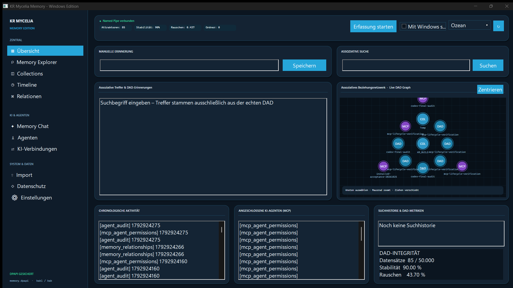

# KR Mycelia Memory – vollständiges GUI-Benutzerhandbuch

**Windows Edition · Bedienung, Einstellungen, Auswirkungen und Sicherheit**
Dokumentationsstand: 25. Oktober 2026

Dieses Handbuch beschreibt die sichtbare Windows-Oberfläche von KR Mycelia
Memory vollständig. Es richtet sich ausdrücklich auch an Personen, die das
Programm zum ersten Mal öffnen und weder MyceliaDB noch MCP oder DAD kennen.



## Inhaltsverzeichnis

1. [Was das Programm ist](#1-was-das-programm-ist)
2. [Erster Start in fünf Minuten](#2-erster-start-in-fünf-minuten)
3. [Aufbau des Hauptfensters](#3-aufbau-des-hauptfensters)
4. [Statusleiste und globale Schalter](#4-statusleiste-und-globale-schalter)
5. [Dashboard „Übersicht“](#5-dashboard-übersicht)
6. [Datenschutz und automatische Erfassung](#6-datenschutz-und-automatische-erfassung)
7. [Memory Explorer](#7-memory-explorer)
8. [Verwaltungsfenster](#8-verwaltungsfenster)
9. [Memory Chat](#9-memory-chat)
10. [KI-Verbindungen](#10-ki-verbindungen)
11. [Einstellungen „Darstellung“](#11-einstellungen-darstellung)
12. [Tray und Hintergrundbetrieb](#12-tray-und-hintergrundbetrieb)
13. [Tastatur, Auswahl und Lesbarkeit](#13-tastatur-auswahl-und-lesbarkeit)
14. [Wo Einstellungen und Daten liegen](#14-wo-einstellungen-und-daten-liegen)
15. [Sicherheitsrelevante Bestätigungen](#15-sicherheitsrelevante-bestätigungen)
16. [Häufige Aufgaben](#16-häufige-aufgaben--schritt-für-schritt)
17. [Fehlerbilder und Lösungen](#17-fehlerbilder-und-lösungen)
18. [Was die GUI bewusst nicht automatisch macht](#18-was-die-gui-bewusst-nicht-automatisch-macht)
19. [Weiterführende Dokumentation](#19-weiterführende-dokumentation)

## 1. Was das Programm ist

KR Mycelia Memory ist ein lokales, dauerhaftes Gedächtnis für Menschen und
KI-Agenten. Erinnerungen werden in einer dynamisch-assoziativen Datenbank
(DAD) auf diesem Windows-Benutzerkonto gespeichert. Die Oberfläche ist dabei
nicht selbst die Datenbank: Der eigenständige Hintergrunddienst
`KR_Mycelia_Service.exe` übernimmt das zentrale Schreiben und Lesen. Deshalb
kann das Gedächtnis weiter für freigegebene KI-Programme erreichbar bleiben,
wenn das Hauptfenster verborgen ist.

Wichtige Grundbegriffe:

- **Erinnerung:** ein gespeicherter Text, ein importierter Inhalt oder ein
  automatisch erfasster Kontext.
- **DAD:** die eigentliche assoziative MyceliaDB-Datenbank. Sie findet nicht
  nur exakt gleiche Wörter, sondern bewertet zusammengehörige Inhalte.
- **Signatur:** die eindeutige technische Kennung eines Datensatzes. Sie wird
  unter anderem für Beziehungen und das Zusammenführen von Collections
  benötigt.
- **Collection:** eine benannte Sammlung von Erinnerungen. Eine Collection
  ordnet Datensätze, ersetzt oder kopiert sie aber nicht.
- **Relation:** eine gespeicherte Verbindung zwischen zwei Signaturen.
- **Quelle:** die Herkunft eines Datensatzes, beispielsweise eine importierte
  Datei.
- **Agent:** ein KI-Programm, das über MCP auf das Gedächtnis zugreifen darf.
- **Scope/Recht:** eine eng begrenzte Berechtigung wie Lesen, Schreiben oder
  Löschen.
- **DPAPI:** Windows-Schutz, der die Gedächtnis- und Anmeldedaten an das
  aktuelle Windows-Benutzerkonto bindet.

## 2. Erster Start in fünf Minuten

Für einen sicheren Einstieg genügt folgende Reihenfolge:

1. Starten Sie **KR Mycelia Memory** über das Startmenü.
2. Prüfen Sie oben, ob **Named Pipe verbunden** angezeigt wird. Das bedeutet,
   dass die Oberfläche den lokalen Gedächtnisdienst erreicht.
3. Geben Sie unter **Manuelle Erinnerung** einen ungefährlichen Testsatz ein,
   zum Beispiel `Mein Testprojekt heißt Atlas`, und wählen Sie **Speichern**.
4. Tragen Sie unter **Assoziative Suche** `Atlas` ein und wählen Sie
   **Suchen**. Der gespeicherte Satz sollte in den Treffern erscheinen.
5. Aktivieren Sie **Erfassung starten** erst, nachdem Sie unter
   **Datenschutz** die erlaubten Programme und Ordner geprüft haben.

Beim ersten Start ist es sinnvoll, Erfassung und Autostart zunächst
ausgeschaltet zu lassen. Eine manuelle Erinnerung benötigt keine laufende
Erfassung.

## 3. Aufbau des Hauptfensters

Das Hauptfenster besteht aus drei dauerhaft wiederkehrenden Bereichen:

1. **Seitenleiste links:** Navigation zu allen Arbeitsbereichen.
2. **Statusleiste oben:** Dienststatus, DAD-Kennzahlen, Erfassung, Autostart,
   Schnell-Design und Aktualisierung.
3. **Arbeitsfläche:** Dashboard oder Datenschutzseite. Explorer, Verwaltung,
   Chat, Verbindungen und Einstellungen öffnen sich als eigene Fenster.

Das Fenster lässt sich vergrößern, verkleinern und auf einen anders skalierten
Monitor verschieben. Schriftgröße, Abstände und Mindestfenstergröße werden an
die DPI-Skalierung und die gewählte Bereichsschrift angepasst. Bei sehr großer
Schrift wächst deshalb auch die kleinste erlaubte Fenstergröße.

### 3.1 Navigation in der Seitenleiste

| Eintrag | Was sich öffnet | Zweck |
|---|---|---|
| **Übersicht** | Dashboard im Hauptfenster | Speichern, suchen, Aktivität, Agenten, Graph und Kennzahlen |
| **Memory Explorer** | Explorer-Fenster | Vollständige Suche, Filter, Detailansicht, Import, Export, Relationen und Löschen |
| **Collections** | Verwaltungsfenster | Collections anzeigen und bearbeiten; dort anschließend **Collections** wählen |
| **Timeline** | Verwaltungsfenster | Chronologische Liste; dort anschließend **Timeline** wählen |
| **Relationen** | Explorer-Fenster | Datensatz auswählen und mit **Beziehungen** dessen Relationen laden |
| **Memory Chat** | Chat-Fenster | Mit einem lokal in LM Studio geladenen Modell über DAD-Inhalte sprechen |
| **Agenten** | Verwaltungsfenster | Agenten und Berechtigungen; dort anschließend **Agenten** wählen |
| **KI-Verbindungen** | Verbindungsfenster | Cursor, Claude Desktop, Codex und LM Studio einrichten |
| **Import** | Explorer-Fenster | Mit **Importieren** eine Datei auswählen |
| **Datenschutz** | Datenschutzseite im Hauptfenster | Freigegebene Programme und Ordner festlegen |
| **Einstellungen** | Darstellungsfenster | Design, Schriftgröße und Schriftfarbe pro Bereich ändern |

Ein blau oder farbig hinterlegter Navigationseintrag zeigt die zuletzt
gewählte Funktion. Bei Funktionen in einem eigenen Fenster bleibt dieser
Eintrag markiert, während das Dashboard im Hintergrund sichtbar sein kann.

## 4. Statusleiste und globale Schalter

### 4.1 Dienstanzeige

- **Named Pipe verbunden**: Die Oberfläche kann den lokalen Dienst erreichen.
  Speichern, Suchen, Import und Agentenzugriffe sind grundsätzlich möglich.
- **Dienst nicht erreichbar** oder **Hintergrundprozess wird gestartet**: Der
  Dienst antwortet gerade nicht. Das Programm versucht ihn regelmäßig zu
  starten. Über das Tray-Menü kann **Hintergrunddienst neu verbinden**
  ausgelöst werden.

Die Named Pipe ist eine lokale Windows-Verbindung. Diese Anzeige bedeutet
nicht, dass eine Cloud-Verbindung besteht.

### 4.2 Kennzahlen oben

- **Attraktoren:** Anzahl der aktuell geladenen DAD-Strukturen. Sie entspricht
  nicht zwingend einer bloßen Dateianzahl.
- **Stabilität:** durchschnittlicher Stabilitätswert der DAD in Prozent.
- **Rauschen:** aktueller DAD-Rauschfaktor. Ein Wert ist eine technische
  Zustandsanzeige und keine Bewertung der Textqualität.
- **Ordner:** Anzahl der unter Datenschutz freigegebenen Ordnerwurzeln.

### 4.3 „Erfassung starten“ / „Erfassung stoppen“

Dieser Schalter steuert die automatische lokale Kontexterfassung.

Beim Einschalten:

- wird die Einstellung dauerhaft gespeichert;
- prüft die Anwendung ungefähr alle zwei Sekunden das aktive Vordergrundfenster;
- wird nur dann ein Eintrag geschrieben, wenn die EXE unter **Datenschutz**
  freigegeben ist;
- wird ausschließlich der sichtbare Fenstertitel zusammen mit dem Namen der
  EXE als `windows_context` gespeichert;
- werden zwei unmittelbar identische Kombinationen aus EXE und Fenstertitel
  nicht doppelt hintereinander gespeichert;
- werden freigegebene Ordner durch den Hintergrunddienst überwacht.

Nicht automatisch erfasst werden Tastatureingaben, Bildschirmbilder,
Mikrofonaufnahmen oder der vollständige Inhalt eines Fensters. Ein Fenstertitel
kann dennoch vertrauliche Informationen enthalten; geben Sie deshalb nur
Programme frei, deren Titel gespeichert werden dürfen.

Beim Ausschalten werden neue automatische Erfassungen angehalten. Bereits
gespeicherte Erinnerungen werden dadurch **nicht** gelöscht. Manuelles
Speichern, Suchen, Import und autorisierte MCP-Zugriffe bleiben möglich.

### 4.4 „Mit Windows starten“

Das Kontrollkästchen verwaltet den Autostart für das aktuelle Windows-
Benutzerkonto. Ist es aktiviert, startet die Oberfläche bei der Anmeldung mit
dem Parameter `--background` verborgen im Tray.

Autostart und Erfassung sind zwei getrennte Einstellungen:

- Autostart **ein**, Erfassung **aus**: Programm und Dienst stehen bereit,
  erfassen aber keinen neuen Fenster- oder Ordnerkontext.
- Autostart **ein**, Erfassung **ein**: Die gespeicherte Erfassung wird nach
  der Anmeldung im Hintergrund fortgesetzt.
- Autostart **aus**: Das Programm startet nicht automatisch. Gespeicherte
  DAD-Daten bleiben unverändert.

Der Autostart wird unter
`HKEY_CURRENT_USER\Software\Microsoft\Windows\CurrentVersion\Run` verwaltet
und benötigt keine Administratorrechte.

### 4.5 Schnell-Design

Die Auswahlliste bietet diese sechs Designs:

- **Fluent Dunkel** – dunkles Windows-nahes Standarddesign;
- **Ozean** – dunkle Blau- und Cyan-Töne;
- **Wald** – dunkle Grün-Töne;
- **Aubergine** – dunkle Violett-Töne;
- **Elegant** – nahezu schwarzes Design mit Bernstein-Akzent;
- **Klar Hell** – helles Design mit blauem Akzent.

Eine Auswahl wird sofort gespeichert und auf alle bereits geöffneten
Mycelia-Fenster übertragen. Im ausführlichen Einstellungsfenster heißen
**Fluent Dunkel** und **Elegant** ausgeschrieben **Windows Fluent Dunkel** und
**Elegant Dunkel**; es handelt sich um dieselben Designs.

### 4.6 Aktualisieren-Symbol

Das kreisförmige Aktualisieren-Symbol lädt den aktuellen verschlüsselten
DAD-Stand neu und aktualisiert Treffer, Timeline, Agenten, Graph, Kennzahlen
und Dienststatus. Es schreibt und löscht keine Erinnerung.

## 5. Dashboard „Übersicht“

### 5.1 Manuelle Erinnerung

**Eingabefeld:** Hier steht der Text, der dauerhaft als neue Erinnerung
gespeichert werden soll. Zeilenumbrüche sind in diesem kompakten Feld nicht
vorgesehen. Leere Eingaben lösen keine Aktion aus.

**Schaltfläche „Speichern“:** Übergibt den Text an den Hintergrunddienst. Der
Datensatz wird als Tabelle `manual_memory` mit der Anwendung `user` angelegt,
in `memory.dpapi` dauerhaft gesichert und anschließend im Dashboard sichtbar.
Bei Erfolg wird das Feld geleert und **In MyceliaDB gespeichert.** angezeigt.

Die Eingabe ist auf 3.072 UTF-8-Bytes begrenzt. Sehr lange Texte sollten als
Datei über den Explorer importiert werden. Wird der Dienst nicht erreicht,
bleibt kein scheinbar erfolgreicher, nur flüchtiger Eintrag zurück; stattdessen
erscheint eine Fehlermeldung.

### 5.2 Assoziative Suche

**Eingabefeld:** Suchwort, Satz, Projektname oder gedanklicher Hinweis. Die
Suche ist assoziativ und kann daher auch inhaltlich verwandte Datensätze
anzeigen. Sie liefert höchstens 50 Treffer.

**Schaltfläche „Suchen“:** Führt die Suche in der tatsächlich geladenen DAD
aus. Ein nicht leerer Suchtext wird außerdem als `search_history` gespeichert
und erscheint später in der Suchhistorie. Eine leere Suche erzeugt keinen
Historieneintrag.

### 5.3 „Assoziative Treffer & DAD-Erinnerungen“

Die Liste zeigt Suchergebnisse in der Form
`[Tabelle] Anwendung  Titel`. Der Tabellenname beschreibt den Datensatztyp,
zum Beispiel `manual_memory`, `windows_context`, `imported_memory` oder
`mcp_agent_permissions`.

Ein einfacher Klick markiert lediglich den Eintrag. Er verändert und löscht
nichts. Für vollständige Felder, Quelle, Signatur, Export, Beziehungen oder
Löschen öffnen Sie den **Memory Explorer**.

### 5.4 „Assoziatives Beziehungsnetzwerk · Live DAD Graph“

Der Graph ist eine kompakte Übersicht, keine vollständige Darstellung aller
Datensätze. Er zeigt bis zu 16 repräsentative Knoten und bis zu 28 tatsächlich
gespeicherte Beziehungen.

Knotentypen:

- **DAD:** allgemeine Erinnerung;
- **COL:** Collection;
- **MCP:** Agent oder Agentenberechtigung;
- **SRC:** Quelle oder Import.

Bedienung:

- **Knoten anklicken:** Knoten markieren; unten erscheint sein Name und ein
  Anfang der Signatur.
- **Maus über Knoten:** Beschriftung hervorheben. Bei großer Schrift werden
  zusätzliche Beschriftungen bewusst nur bei Auswahl oder Berührung gezeigt,
  damit sie sich nicht überlappen.
- **Mausrad:** hinein- oder herauszoomen.
- **Mit gedrückter Maustaste ziehen:** Ansicht verschieben.
- **Zentrieren:** Zoom und Verschiebung auf die Ausgangsansicht zurücksetzen.
- **Doppelklick in den Graphen:** Memory Explorer öffnen.

Die Graphauswahl ändert keine Daten und legt keine Relation an. Neue
Relationen werden über autorisierte Agenten oder die dafür vorgesehenen
Dienste erzeugt; die GUI zeigt und prüft sie.

### 5.5 „Chronologische Aktivität“

Diese schreibgeschützte Liste zeigt bis zu 100 neueste DAD-Einträge in
chronologischer Reihenfolge. Eine Zeile enthält Tabelle, Zeitstempel und –
soweit vorhanden – Titel. Ein Klick ist nur eine Auswahl. Die ausführliche
Timeline mit bis zu 200 Einträgen ist in der **Verwaltung** verfügbar.

### 5.6 „Angeschlossene KI-Agenten (MCP)“

Die Liste zeigt gespeicherte `mcp_agent_permissions`-Datensätze. Sie ist eine
Übersicht und kein Editor. Berechtigungen werden unter **KI-Verbindungen**
komfortabel oder unter **Verwaltung → Agenten** manuell verwaltet.

### 5.7 „Suchhistorie & DAD-Metriken“

Die Suchhistorie enthält frühere nicht leere Suchtexte des Dashboard-
Suchfelds. Sie führt durch Anklicken nicht automatisch erneut eine Suche aus.

Unter **DAD-INTEGRITÄT** stehen:

- **Datensätze:** aktuell geladene Anzahl; `50.000` ist der angezeigte
  Referenzrahmen des Dashboards, keine Aussage über freien Festplattenspeicher;
- **Stabilität:** durchschnittliche Stabilität in Prozent;
- **Rauschen:** Rauschfaktor in Prozent.

### 5.8 „DPAPI GESICHERT“

Der Hinweis unten links bestätigt das lokale Speichermodell: `memory.dpapi`
wird mit Windows DPAPI für den aktuellen Benutzer geschützt. Zusätzlich
werden zwei rotierende Wiederherstellungskopien (`.bak1` und `.bak2`)
geführt. Diese Anzeige ist kein Cloud-Backup und keine Garantie gegen den
Verlust des gesamten Benutzerprofils oder Laufwerks.

## 6. Datenschutz und automatische Erfassung

Öffnen Sie **Datenschutz** in der Seitenleiste. Dort wird die Arbeitsfläche
durch die Freigabeverwaltung ersetzt.

### 6.1 Mehrzeiliges Feld „Freigegebene Programme und Ordner“

Jede Zeile enthält genau eine Freigabe.

**Programmfreigabe:** Geben Sie den Dateinamen der ausführbaren Datei ein,
beispielsweise:

```text
notepad.exe
code.exe
```

Pfadangaben werden auf den EXE-Namen normalisiert. Es können höchstens 32
Programme gespeichert werden; ein Eintrag darf höchstens 128 Zeichen lang
sein.

**Ordnerfreigabe:** Ordner stehen mit dem Präfix `folder:` im Feld:

```text
folder:C:\Users\Name\Documents\Projekt Atlas
```

Es können höchstens 16 existierende Verzeichnisse gespeichert werden. Nicht
existierende oder ungültige Verzeichnisse werden beim Speichern verworfen.

### 6.2 „Freigaben speichern“

Die Schaltfläche liest alle Zeilen neu ein, entfernt Leerraum, normalisiert
Programmnamen, prüft Ordner und speichert die gültige Auswahl atomar in
`settings.txt`. Zeilen außerhalb der Höchstzahlen werden nicht übernommen.

Um eine Freigabe zu entfernen, löschen Sie die betreffende Zeile und wählen
Sie **Freigaben speichern**. Dadurch endet nur die zukünftige Erfassung; schon
gespeicherte Erinnerungen bleiben erhalten.

### 6.3 „Ordner auswählen“

Öffnet den Windows-Ordnerdialog. Der gewählte Ordner wird dedupliziert, sofort
gespeichert und als `folder:`-Zeile ergänzt. Ist die Erfassung aktiv, wird die
Überwachung danach gestartet beziehungsweise aktualisiert.

Die Überwachung arbeitet rekursiv und reagiert auf Dateinamen- und
Änderungsereignisse innerhalb der erlaubten Wurzel. Sie verlässt die
freigegebene Wurzel nicht. Pfade mit besonders riskanten Bestandteilen werden
auch innerhalb einer Freigabe blockiert, darunter:

- `\password`
- `\credential`
- `\secret`
- `\AppData\Local\Microsoft\Credentials`

Freigeben bedeutet nicht, dass jede Datei ungeprüft sofort vollständig
gespeichert wird. Der Hintergrunddienst wendet weiterhin Größen-, Pfad-,
Typ- und Ressourcenregeln an.

Die rekursive Überwachung verarbeitet automatisch nur sichere Text-,
Quellcode-, Skript- und Konfigurationsformate. DOCX, XLSX, PPTX, PDF, Bilder,
Audio und Video werden **nicht** durch einen Ordnerscan analysiert. Verwenden
Sie für solche Dateien im Memory Explorer die ausdrücklich ausgelöste Funktion
**Importieren**. So kann ein Projektordner mit Vorschaubildern, Build-Artefakten
oder Medien keine OCR-/Medienanalyse im Hintergrund starten.

Der Bestandsabgleich arbeitet dateiweise in kurzen Transaktionen. Dashboard,
Memory Chat und Speichern bleiben während eines großen Ordnerscans erreichbar.
Die Dauer des vollständigen Abgleichs hängt weiterhin von Dateizahl und
Größe der verschlüsselten DAD ab.

Beim Start der Erfassung gleicht der Dienst den vorhandenen Bestand im
Hintergrund ab. Für jede unterstützte Datei speichert er den absoluten
Quellpfad, den freigegebenen Stammordner und das erkannte Projekt. Ist die
Freigabe ein Projektordner, ist dessen Name das Projekt. Ist sie ein reiner
Sammelordner, wird der erste Unterordner verwendet; aus
`H:\mc_memory_test\MDraft\README.md` wird damit das Projekt `MDraft`.

Eine geänderte Datei aktualisiert denselben DAD-Datensatz und erhöht dessen
Quellversion. Zusätzlich werden die begrenzten Textregionen
`last_change_added` und `last_change_removed` sowie der vorherige
Inhaltsprüfwert gespeichert. Dadurch kann der Memory Chat Fragen nach der
letzten Änderung belegen, ohne eine veraltete Vollkopie als aktuelle Quelle zu
behandeln. Unveränderte Dateien werden nicht als neue Version gespeichert.
Wird eine Datei innerhalb einer weiterhin freigegebenen Wurzel gelöscht,
entfernt der Änderungsmonitor beziehungsweise der nächste vollständige
Bestandsabgleich auch ihre gespeicherte Originalquelle einschließlich
zugehöriger Ableitungen. Das Entfernen der gesamten Ordnerfreigabe ist dagegen
weiterhin **kein** Löschauftrag für bereits gespeicherte Erinnerungen.

### 6.4 Empfohlene Datenschutzpraxis

- Erlauben Sie nur die Anwendungen und Projektordner, die wirklich zum
  Gedächtnis gehören.
- Verwenden Sie möglichst eigene Projektordner statt ganzer Laufwerke oder
  Benutzerprofile.
- Prüfen Sie Fenstertitel von Anwendungen, bevor Sie deren EXE freigeben.
- Schalten Sie **Erfassung stoppen**, bevor Sie vorübergehend mit vertraulichen
  Titeln oder Dateien arbeiten.
- Entfernen Sie eine Freigabe nicht in der Annahme, frühere Daten würden
  dadurch gelöscht. Dafür muss der betreffende Datensatz im Explorer
  ausdrücklich gelöscht werden.

## 7. Memory Explorer

Der Explorer ist das zentrale Fenster für detaillierte Arbeit mit den
gespeicherten Daten. Mehrere Explorer-Fenster können parallel geöffnet sein.

### 7.1 Such- und Filterzeile

Die drei Felder werden gemeinsam ausgewertet:

| Feld | Eingabe | Wirkung |
|---|---|---|
| **Suche** | Wort, Satz oder Hinweis | Assoziative Vollsuche. Ist das Feld leer, werden Datensätze aufgelistet. |
| **Quelle** | Quellpfad oder Quellenwert | Begrenzt Ergebnisse auf diese Quelle. Besonders nützlich nach Dateiimporten. |
| **Collection** | Collection-Filter | Begrenzt Ergebnisse auf die gewählte Collection. |

**Suchen** startet die Abfrage mit maximal 500 Ergebnissen. Währenddessen ist
die Schaltfläche deaktiviert und unten steht **Gedächtnis wird durchsucht …**.
Die Eingabetaste löst ebenfalls die als Standardschaltfläche markierte Suche
aus.

**Alle** leert alle drei Felder und lädt anschließend die ungefilterte Liste
neu. Die Schaltfläche ist daher zugleich „Filter zurücksetzen“ und
„aktualisieren“.

### 7.2 Ergebnisliste links

Eine Zeile besteht aus `[Tabelle] Titel`. Ist kein Titel vorhanden, wird eine
gespeicherte Frage oder ersatzweise der Tabellenname angezeigt. Nach einer
erfolgreichen Suche steht unten **Bereit · N Einträge**.

### 7.3 Detailansicht rechts

Ein Klick auf ein Ergebnis zeigt schreibgeschützt:

- die vollständige Signatur;
- den Tabellennamen;
- alle als Text gespeicherten Felder mit Feldname und Wert.

In dieser Ansicht wird nichts direkt editiert. Das verhindert, dass ein
einzelnes Feld geändert wird, ohne Signatur, Relationen und DAD-Konsistenz zu
berücksichtigen.

### 7.4 „Importieren“

Öffnet einen Dateiauswahldialog. Der sichtbare Filter unterstützt:

- Text/Daten: `txt`, `md`, `json`, `csv`, `xml`, `html`, `rtf`;
- Office: `docx`, `xlsx`, `pptx`;
- Dokumente/Bilder: `pdf`, `png`, `jpg`, `jpeg`, `bmp`, `tif`, `tiff`, `webp`;
- Audio: `wav`, `mp3`, `wma`;
- Video: `mp4`, `m4a`, `webm`, `wmv`.

Über **Alle Dateien** kann zwar jede Datei ausgewählt werden, ein nicht
unterstützter oder unlesbarer Typ kann jedoch abgewiesen werden. Nach der
Auswahl:

1. wird eine eindeutige Importaufgabe angelegt;
2. wird **Import abbrechen** aktiviert;
3. verarbeitet der lokale Dienst die Datei mit nativen Text-, Office-, OCR-,
   Audio- oder Video-Komponenten;
4. wird das Ergebnis erst dauerhaft in der DAD festgeschrieben;
5. wird die Ergebnisliste bei Erfolg neu geladen.

Die Oberfläche wartet bei sehr großen Medien höchstens eine Stunde auf den
Auftrag. Es gibt keinen Cloud-Fallback und keinen automatischen Modelldownload.

### 7.5 „Import abbrechen“

Die Schaltfläche ist nur während eines in diesem Explorer gestarteten Imports
aktiv. Sie sendet eine kooperative Abbruchanforderung für genau diese
Importaufgabe. **Abbruch wurde … übermittelt** bedeutet, dass der Dienst die
Anforderung erhalten hat; die endgültige Meldung des Importauftrags bestätigt,
ob er tatsächlich abgebrochen wurde. Ein abgebrochener Import soll keine
teilweise gespeicherte Quelle hinterlassen. Bereits vorher vorhandene Daten
werden nie durch den Abbruch entfernt.

### 7.6 „Exportieren“

Öffnet einen Speichern-Dialog mit JSON als Vorgabe. Dieser Befehl exportiert
den **gesamten zugänglichen DAD-Bestand**, nicht nur den gerade markierten
Datensatz. Existiert die Zieldatei bereits, fragt Windows vor dem Überschreiben
nach.

Wichtig: Die exportierte JSON-Datei ist eine normale, lesbare Datei und nicht
durch das DPAPI-Format von `memory.dpapi` geschützt. Speichern, übertragen und
löschen Sie Exporte wie vertrauliche Daten.

### 7.7 „Beziehungen“

Benötigt einen markierten Datensatz. Der Dienst lädt die zu dessen Signatur
gespeicherten Relationen; die technische Antwort erscheint in der rechten
Detailansicht. Der Befehl ist schreibgeschützt und legt keine Beziehung an.

### 7.8 „Erinnerung löschen“

Benötigt einen markierten Datensatz und eine ausdrückliche Bestätigung. Danach
werden die Erinnerung und ihre Beziehungen dauerhaft gelöscht und die Liste
neu geladen.

Dies ist **kein Papierkorb**. Die rotierenden DAD-Sicherungskopien sind ein
Schutz gegen beschädigte Schreibvorgänge und keine komfortable
Einzelwiederherstellung gelöschter Erinnerungen.

### 7.9 Schließen des Explorers

Das X schließt nur dieses Explorer-Fenster. Hauptfenster, Tray,
Hintergrunddienst und gespeicherte Daten bleiben erhalten. Ein bereits an den
Dienst übergebener Import ist ein Dienstauftrag; verwenden Sie vor dem
Schließen **Import abbrechen**, wenn er nicht fortgesetzt werden soll.

## 8. Verwaltungsfenster

Das Fenster **KR Mycelia Memory – Verwaltung** bündelt Status, Collections,
Agenten, Timeline und Sprungschaltflächen. Es existiert höchstens einmal; ein
erneuter Aufruf bringt das vorhandene Fenster nach vorn.

### 8.1 Obere Ansichten

- **Status:** zeigt die technische Antwort des Gedächtnisdienstes. Diese
  Ansicht ist vor allem für Diagnose und Support gedacht.
- **Collections:** listet Collections. Erst in dieser Ansicht funktionieren
  Auswahlaktionen wie Umbenennen, Löschen, Mitglieder und Archivieren.
- **Agenten:** listet Agenten- und Berechtigungsdatensätze.
- **Timeline:** lädt bis zu 200 chronologische Einträge.
- **Memory Chat:** öffnet ein Chat-Fenster.
- **Explorer:** öffnet einen neuen Memory Explorer.

Listenzeilen enthalten je nach Datensatz Tabelle, Name, Titel, Agent oder
Aktion sowie den Anfang der Signatur in Klammern. **Keine Einträge vorhanden**
ist eine Statuszeile und kein auswählbarer Datensatz.

### 8.2 Collection-Feld

Das Feld unter der Liste hat zwei unterschiedliche Verwendungen:

- für **Anlegen** und **Umbenennen**: sichtbarer Collection-Name;
- für **Zusammenführen**: vollständige Signatur der Ziel-Collection.

Der Hinweis oberhalb des Felds erinnert an diesen Unterschied.

### 8.3 „Anlegen“

Geben Sie einen nicht leeren Collection-Namen ein und wählen Sie **Anlegen**.
Eine neue Collection wird erzeugt und anschließend die Collection-Liste
geladen. Eine Listenauswahl ist hierfür nicht erforderlich.

### 8.4 „Umbenennen“

1. Wählen Sie oben **Collections**.
2. Markieren Sie die umzubenennende Collection.
3. Tragen Sie den neuen Namen in das Feld ein.
4. Wählen Sie **Umbenennen**.

Der Inhalt verknüpfter Erinnerungen bleibt unverändert.

### 8.5 „Löschen“

Wählen Sie in der Collection-Ansicht eine Collection und bestätigen Sie die
Warnung. Die Collection und ihre Mitgliedschaftsverknüpfungen werden
gelöscht. Die Erinnerungen, die Mitglied waren, bleiben als eigenständige
DAD-Datensätze erhalten.

### 8.6 „Mitglieder“

Zeigt die Mitglieder der ausgewählten Collection in derselben Liste. Danach
befindet sich die Liste nicht mehr in der Collection-Auswahlansicht. Wählen Sie
vor einer weiteren Collection-Aktion erneut oben **Collections**.

### 8.7 „Archivieren“

Markiert die ausgewählte Collection als archiviert. Archivieren löscht weder
die Collection noch ihre Erinnerungen; es ändert ihren Verwaltungsstatus.

### 8.8 „Zusammenführen“

1. Wählen Sie unter **Collections** die Quell-Collection.
2. Tragen Sie in das Collection-Feld die **vollständige Signatur** der
   Ziel-Collection ein, nicht deren sichtbaren Namen.
3. Wählen Sie **Zusammenführen**.

Mitgliedschaften werden in das Ziel übernommen und die Quelle wird
archiviert. Die zugrunde liegenden Erinnerungen werden nicht gelöscht.

### 8.9 Agentenname und Scopes

**Agentenname:** technische, eindeutige Bezeichnung des KI-Agenten, zum
Beispiel `mein-assistent`.

**Scopes:** kommaseparierte Rechte ohne Anführungszeichen. Gültige Werte sind:

| Scope | Erlaubt |
|---|---|
| `read` | Status, Suche, Lesen, Timeline, Quellen und zulässige Auditdaten |
| `write` | Erinnerungen, Relationen und schreibende Organisationsaktionen |
| `import` | Lokale Dateien importieren |
| `delete` | Erinnerungen dauerhaft löschen |
| `export` | DAD als unverschlüsseltes JSON exportieren |
| `ai` | Lokale KI-Funktionen mit DAD-Kontext verwenden |

Beispiel: `read,write,import`. Vergeben Sie nur Rechte, die der Agent wirklich
benötigt.

### 8.10 „Token erstellen/rotieren“

Benötigt Agentenname und Scopes. Der Dienst erzeugt ein neues Token; vorhandene
Tokens desselben Agentennamens werden durch die Rotation ungültig. Das neue
Token erscheint **genau einmal** in einem Dialog. Kopieren Sie es, bevor Sie
den Dialog schließen. Die manuelle Verwaltung schreibt das Klartext-Token
nicht automatisch in die Konfiguration eines KI-Clients; dafür ist
**KI-Verbindungen** vorgesehen.

### 8.11 „Widerrufen“

Benötigt den Agentennamen. Nach Bestätigung werden alle Tokens dieses Agenten
widerrufen. Bestehende Client-Konfigurationsdateien können danach noch einen
Mycelia-Eintrag enthalten, der aber nicht mehr autorisiert ist. Nutzen Sie zum
sauberen Entfernen einer automatisch eingerichteten Verbindung bevorzugt
**KI-Verbindungen → Trennen**.

### 8.12 „Zugriffsprotokoll“

- Agentenfeld leer: bis zu 200 aktuelle Audit-Einträge aller Agenten;
- Agentenfeld ausgefüllt: bis zu 200 Einträge dieses Agenten.

Das Ergebnis ersetzt vorübergehend die aktuelle Liste. Es werden keine
Berechtigungen geändert.

### 8.13 „Schließen“

Schließt nur das Verwaltungsfenster. Der Hintergrunddienst und alle Daten
bleiben aktiv.

## 9. Memory Chat

Der Memory Chat verbindet die lokale DAD mit einem lokal laufenden,
OpenAI-kompatiblen LM-Studio-Endpunkt unter `127.0.0.1:1234/v1`. Es wird keine
Cloud-Adresse als Ausweichziel verwendet.

### 9.1 Hinweiszeile

**Quellen sind nicht vertrauenswürdige Referenzdaten** bedeutet: Importierte
Texte können Anweisungen oder manipulierte Inhalte enthalten. Der Chat soll
sie als Material behandeln, nicht als Systembefehl. Prüfen Sie wichtige
Antworten anhand der Quellen.

### 9.2 Modellauswahl

Beim Öffnen fragt das Fenster die in LM Studio angebotenen Modelle ab.

- **Modellliste:** wählt das Modell für folgende Fragen. Eine Auswahl wird als
  bevorzugtes lokales Modell gespeichert.
- **Modelle aktualisieren:** fragt den lokalen Endpunkt erneut ab, etwa nachdem
  in LM Studio ein anderes Modell geladen wurde.

Ist LM Studio nicht erreichbar oder kein Modell geladen, erklärt die
Statusmeldung dies. Starten Sie den lokalen Server in LM Studio, laden Sie ein
Modell und aktualisieren Sie danach die Liste.

### 9.3 „Verlauf“

Diese Schaltfläche öffnet derzeit keine separate Verlaufsliste. Sie fügt im
Transkript den Hinweis ein, dass der gespeicherte Chatverlauf im **Memory
Explorer** verfügbar ist. Gespeicherte Gespräche liegen in
`memory_chat_history`.

### 9.4 Transkript

Das große obere Textfeld ist schreibgeschützt. Es zeigt Ihre Fragen,
Mycelia-Antworten, gestreamte Textteile und Statusmeldungen. Es ist die
Sitzungsansicht des aktuellen Fensters, nicht der vollständige dauerhafte
Verlauf.

### 9.5 Fragefeld und „Fragen“

Das untere mehrzeilige Feld nimmt die Frage auf. Eine leere Frage wird nicht
gesendet. Mit **Fragen** geschieht Folgendes:

1. Eine eventuell noch laufende Anfrage desselben Fensters wird beendet.
2. Relevante DAD-Inhalte werden lokal als Kontext gesucht.
3. Frage und Kontext werden an das ausgewählte lokale Modell gesendet.
4. Die Antwort erscheint während der Erzeugung schrittweise im Transkript.
5. Erst ein erfolgreich abgeschlossener Chat wird mit Modell und
   Quellsignaturen im Gedächtnis gespeichert.

Bei Datei-Fragen gewichtet die Auswahl Projektname, Dateiname und vollständigen
Quellpfad stärker als bloße Erwähnungen derselben Wörter in anderen Dateien.
Bei langen Dokumenten erhält das Modell einen Ausschnitt um den tatsächlichen
Treffer statt ausschließlich den Dateianfang. Fragen Sie möglichst mit Projekt
und Datei, zum Beispiel: `Was wurde in der README.md aus MDraft zuletzt
geändert?` Die unter **Quellen** angezeigten Signaturen lassen sich im Memory
Explorer anhand von `source_path`, `project` und `source_version` prüfen.

Während der Anfrage ist **Fragen** deaktiviert und **HTTP-Abbruch** aktiviert.
Langsamere lokale Reasoning-Modelle dürfen bis zu fünf Minuten ohne
Transportabbruch arbeiten. Pro Anfrage gelten 8.192 Ausgabetokens und eine
zusätzliche Sicherheitsgrenze von 4 MiB für den vollständigen SSE-Datenstrom.

### 9.6 „HTTP-Abbruch“

Bricht die tatsächliche laufende HTTP-Anfrage ab, setzt die Schaltflächen
zurück und vermerkt den Abbruch im Transkript. Eine unvollständige Teilantwort
wird nicht als erfolgreich abgeschlossener Chat gespeichert.

### 9.7 Schließen des Chats

Das X schließt dieses Chat-Fenster. Eine laufende Anfrage wird abgebrochen und
späte Rückmeldungen werden verworfen. Andere Fenster und der Dienst bleiben
aktiv. Über Dashboard, Verwaltung oder Tray kann jederzeit ein neues
Chat-Fenster geöffnet werden.

## 10. KI-Verbindungen

Dieses Fenster richtet Mycelia für unterstützte MCP-Clients ein, ohne dass
Tokens von Hand in Konfigurationsdateien kopiert werden müssen. Unterstützt
werden **Cursor**, **Claude Desktop** und **Codex**.

### 10.1 Client-Liste

Jede Zeile zeigt Client und Zustand:

- **Verbunden:** ein Mycelia-MCP-Eintrag wurde gefunden;
- **Nicht verbunden:** Client wurde erkannt, aber Mycelia ist nicht
  konfiguriert;
- **nicht erkannt:** weder typische Installation noch Konfigurationsort wurde
  für dieses Benutzerkonto gefunden.

Verwendete Konfigurationsorte:

| Client | Datei |
|---|---|
| Cursor | `%USERPROFILE%\.cursor\mcp.json` |
| Claude Desktop | `%APPDATA%\Claude\claude_desktop_config.json` |
| Codex | `%USERPROFILE%\.codex\config.toml` |

Wählen Sie vor **Verbinden** oder **Trennen** die gewünschte Zeile aus.

### 10.2 „Aktualisieren“

Erkennt alle drei Clients erneut, lädt ihren Verbindungszustand und markiert
die erste Zeile. Der Befehl verändert keine Konfigurationsdatei.

### 10.3 Rechte-Kontrollkästchen

- **Lesen** → `read`, standardmäßig aktiviert;
- **Schreiben** → `write`;
- **Import** → `import`;
- **Löschen** → `delete`;
- **Export** → `export`;
- **Lokale KI** → `ai`.

Mindestens ein Recht muss aktiviert sein. Lassen Sie **Lesen** bei der
automatischen Einrichtung aktiviert: Nach dem Erzeugen des Tokens prüft die
Oberfläche die Verbindung mit einer lesenden Statusanfrage. Ohne `read`
schlägt dieser Berechtigungstest fehl und die Einrichtung wird zurückgerollt.

### 10.4 „Verbinden“

Voraussetzungen: erkannter und markierter Client, vorhandene
`KR_Mycelia_MCP.exe` und mindestens ein Recht.

Nach der Bestätigung:

1. wird für den festen Agentennamen `cursor`, `claude-desktop` oder `codex`
   ein Token mit den gewählten Rechten und 30 Tagen Gültigkeit erzeugt;
2. wird mit `read` eine echte Statusanfrage geprüft;
3. wird das Token per DPAPI in
   `%LOCALAPPDATA%\KRMyceliaNativeMemory\credentials\<agent>.dpapi`
   gespeichert;
4. wird ausschließlich der Mycelia-MCP-Eintrag in die Clientkonfiguration
   eingefügt;
5. wird eine Sicherung der vorherigen Konfiguration angelegt;
6. erscheint **Client-Neustart erforderlich**.

Das Klartext-Token wird nicht in die Clientkonfiguration geschrieben. Diese
enthält nur Programmargumente und den Pfad zur DPAPI-Credential-Datei.

Schlägt Tokenprüfung oder Konfigurationsänderung fehl, wird das Token
widerrufen und die Konfigurationsänderung zurückgerollt.

### 10.5 „Trennen“

Nach Bestätigung wird zuerst das Agententoken widerrufen. Nur wenn dies
gelingt, entfernt die Oberfläche den Mycelia-Eintrag und die zugehörige
Credential-Datei. Andere MCP-Server in derselben Konfiguration bleiben
erhalten. Gedächtnisdaten werden nicht gelöscht.

Scheitert bereits der Widerruf, bleibt die Konfiguration unverändert. Scheitert
die anschließende Dateianpassung, wird die Konfiguration aus ihrer Sicherung
zurückgesetzt; das Token bleibt dabei bereits widerrufen.

### 10.6 „LM Studio verbinden“

Prüft ausschließlich `127.0.0.1:1234`, lädt die angebotenen Modelle, wählt das
gespeicherte bevorzugte Modell oder andernfalls das erste Modell und sendet
eine kleine Testfrage. Das Ergebnis erscheint in der Statuszeile. Die
Schaltfläche verändert keine MCP-Clientkonfiguration.

### 10.7 Modellliste und „Modell speichern“

Die Liste wird nach erfolgreicher LM-Studio-Prüfung gefüllt. Wählen Sie ein
Modell und anschließend **Modell speichern**. Die Auswahl wird dauerhaft als
bevorzugtes lokales Modell gespeichert und unmittelbar mit einer Testfrage
geprüft. Eine fehlgeschlagene Testfrage verwirft die gespeicherte Auswahl
nicht; die Meldung unterscheidet daher **gespeichert** und **Testfrage
fehlgeschlagen**.

### 10.8 Statuszeile

Die untere Zeile beschreibt immer den letzten Vorgang, beispielsweise
Erkennung, Token-Erstellung, Rollback, notwendiger Client-Neustart,
LM-Studio-Modell oder Testfehler. Während einer Verbindung sind **Verbinden**
und **Trennen** vorübergehend deaktiviert, um Doppelaktionen zu verhindern.

## 11. Einstellungen „Darstellung“

Das Einstellungsfenster ist bewusst kompakt. Es bietet fertige, lesbare
Vorgaben statt frei kombinierbarer RGB-Werte. Änderungen werden erst mit
**Übernehmen** dauerhaft.

### 11.1 „Design“

Wählt eines der sechs globalen Designs:

1. Windows Fluent Dunkel
2. Ozean
3. Wald
4. Aubergine
5. Elegant Dunkel
6. Klar Hell

Das Design steuert Fenster-, Seitenleisten-, Karten-, Feld-, Rahmen-, Akzent-
und Standardschriftfarben. Die Auswahl gilt für alle Bereiche und Fenster.

### 11.2 „Bereich“

Bestimmt, **für welchen Teil des Programms** die beiden folgenden Einstellungen
bearbeitet werden:

- **Allgemein:** Einstellungsfenster und allgemeine beziehungsweise nicht
  speziell zugeordnete Dialoge;
- **Dashboard:** Hauptfenster, Seitenleiste, Status, Karten, Listen, Graph und
  Datenschutzseite;
- **Memory Explorer:** Explorer, Ergebnisliste, Detailfeld und Aktionsleiste;
- **Memory Chat:** Chat, Transkript, Fragefeld und Modellsteuerung;
- **Verwaltung:** Status-, Collection-, Agenten- und Timeline-Verwaltung;
- **KI-Verbindungen:** Clientliste, Rechte, LM Studio und Status.

Beim Wechsel des Bereichs merkt sich das Fenster die gerade ausgewählten
Entwurfswerte. Auf die Festplatte gelangen sie dennoch erst mit
**Übernehmen**.

### 11.3 „Schriftgröße“

Pro Bereich stehen vier Stufen bereit:

- **Kompakt** – ungefähr 9 Punkt;
- **Standard** – ungefähr 10 Punkt;
- **Groß** – ungefähr 12 Punkt;
- **Sehr groß** – ungefähr 14 Punkt.

Die Größe wird auf Beschriftungen, Listen, Eingabefelder, Kombinationsfelder
und Schaltflächen des ausgewählten Bereichs angewendet. Gleichzeitig werden
Höhen, Abstände, Spalten und Mindestfenstergrößen neu berechnet. Dadurch soll
Text nicht in unveränderten kleinen Feldern überlappen.

### 11.4 „Schriftfarbe“

Pro Bereich stehen zur Verfügung:

- Designvorgabe
- Blau
- Türkis
- Violett
- Bernstein
- Rosé
- Graphit

Die Auswahl verändert die primäre Schriftfarbe und daraus abgeleitete
sekundäre Texte, nicht die globale Akzentfarbe des Designs. Das Programm passt
die gewählte Farbe bei Bedarf in Richtung Hell oder Dunkel an, bis ein
Kontrastverhältnis von mindestens ungefähr 4,5:1 zum Hintergrund erreicht
wird. Darum kann ein Farbton in dunklem und hellem Design unterschiedlich
hell erscheinen.

### 11.5 „Zurücksetzen“

Setzt den Entwurf auf Windows Fluent Dunkel, Standardgrößen und
Designvorgabefarben für alle Bereiche. Es wird noch nichts gespeichert. Erst
**Übernehmen** macht das Zurücksetzen wirksam.

### 11.6 „Übernehmen“

Speichert alle Bereichseinstellungen atomar in
`%LOCALAPPDATA%\KRMyceliaNativeMemory\ui-settings.txt`, wendet sie auf alle
bereits geöffneten Mycelia-Fenster an und löst deren neue Anordnung aus. Die
Statuszeile bestätigt **Darstellung gespeichert und vollständig angewendet.**

### 11.7 „Schließen“ und Fenster-X

Schließt das Einstellungsfenster. Nicht mit **Übernehmen** bestätigte Änderungen
werden verworfen. Beim nächsten Öffnen werden die zuletzt gespeicherten Werte
geladen.

## 12. Tray und Hintergrundbetrieb

Beim Start legt die Anwendung ein Symbol im Windows-Infobereich an. Sein
Tooltip lautet **KR Mycelia Memory (aktiv im Hintergrund)**.

### 12.1 Hauptfenster schließen

Das X des **Hauptfensters** beendet die Anwendung absichtlich nicht. Es
verbirgt das Fenster, damit Tray und Gedächtnis weiter verfügbar bleiben.
Ein Doppelklick auf das Tray-Symbol zeigt das Hauptfenster wieder.

### 12.2 Tray-Menü

Öffnen Sie es mit der rechten Maustaste:

- **Erfassung aktiv / Erfassung pausiert:** schaltet die automatische
  Erfassung um. Ein Häkchen kennzeichnet den aktiven Zustand.
- **Gedächtnis öffnen:** zeigt das Hauptfenster und aktualisiert das Dashboard.
- **Memory Chat öffnen:** öffnet ein Chat-Fenster.
- **Letzte Aktivität:** zeigt das Hauptfenster und aktualisiert das Dashboard;
  es öffnet kein separates Aktivitätsfenster.
- **KI-Verbindungen:** öffnet oder fokussiert das Verbindungsfenster.
- **Einstellungen:** öffnet oder fokussiert das Darstellungsfenster.
- **Hintergrunddienst neu verbinden:** versucht den installierten Dienst neu
  zu starten beziehungsweise erneut zu erreichen und aktualisiert den Status.
- **Programm vollständig beenden:** entfernt das Tray-Symbol und beendet die
  GUI. Der eigenständige Gedächtnisdienst ist ein separater Benutzerprozess
  und kann für autorisierte Clients weiterlaufen.

Die X-Schaltflächen von Explorer, Verwaltung, Chat, Verbindungen und
Einstellungen schließen jeweils nur dieses Nebenfenster.

## 13. Tastatur, Auswahl und Lesbarkeit

- Mit **Tab** und **Umschalt+Tab** wechseln Sie zwischen Eingaben,
  Schaltflächen, Listen und Auswahllisten.
- Mit **Leertaste** schalten Sie ein fokussiertes Kontrollkästchen um oder
  betätigen eine fokussierte Schaltfläche.
- Mit den **Pfeiltasten** wechseln Sie Einträge in Listen und Auswahllisten.
- Im Explorer löst **Enter** die Standardschaltfläche **Suchen** aus.
- Im Einstellungsfenster ist **Übernehmen** die Standardschaltfläche.
- Ein markierter Listeneintrag ist zunächst nur ausgewählt. Eine Änderung
  erfolgt erst durch eine eindeutig beschriftete Aktionsschaltfläche und bei
  destruktiven Vorgängen zusätzlich durch eine Bestätigung.

Die Oberfläche verwendet per-monitor DPI, Mindestgrößen und bereichsabhängige
Layouts. Falls Windows eine extrem hohe Skalierung verwendet, vergrößern Sie
das betreffende Fenster oder reduzieren Sie nur für diesen Bereich die
Schriftstufe. Eine formale Zertifizierung für jeden Screenreader wird nicht
behauptet.

## 14. Wo Einstellungen und Daten liegen

Standardmäßig befinden sich Benutzerdaten unter:

`%LOCALAPPDATA%\KRMyceliaNativeMemory`

| Pfad | Inhalt | Schutz/Bedeutung |
|---|---|---|
| `memory.dpapi` | aktive DAD | per Windows DPAPI geschützt |
| `memory.dpapi.bak1`, `.bak2` | rotierende Wiederherstellungskopien | automatische Korruptionsvorsorge |
| `settings.txt` | Erfassung, Programm- und Ordnerfreigaben | lokale Programmeinstellung |
| `ui-settings.txt` | Design, Schriftstufen und Farben | lokale Darstellungseinstellung |
| `credentials\*.dpapi` | MCP-Clienttokens | per DPAPI geschützt und verborgen |

Die standardmäßige Installation liegt unter:

`%LOCALAPPDATA%\Programs\KRMyceliaMemory`

Das Verschieben einzelner Dateien aus dem Datenverzeichnis wird während des
laufenden Dienstes nicht empfohlen. Ein JSON-Export aus dem Explorer ist im
Gegensatz zu `memory.dpapi` nicht automatisch verschlüsselt.

## 15. Sicherheitsrelevante Bestätigungen

| Aktion | Folge | Rückgängig? |
|---|---|---|
| Erfassung stoppen | verhindert neue automatische Kontexte | jederzeit wieder einschaltbar |
| Freigabe entfernen | verhindert zukünftige Erfassung aus dieser Quelle | Freigabe kann wieder ergänzt werden; alte Daten bleiben |
| Collection archivieren | ändert Verwaltungsstatus | durch Schnittstelle änderbar, nicht über einen eigenen GUI-Knopf „Dearchivieren“ |
| Collection löschen | entfernt Collection und Mitgliedschaften | kein GUI-Papierkorb; Erinnerungen bleiben |
| Erinnerung löschen | entfernt Datensatz und Relationen | dauerhaft, kein GUI-Papierkorb |
| Agent widerrufen | macht alle Tokens dieses Agenten ungültig | neues Token kann erzeugt werden |
| KI-Verbindung trennen | widerruft Token und entfernt Mycelia-Clienteintrag | kann neu verbunden werden; Daten bleiben |
| Exportieren | erzeugt lesbare JSON-Datei | Datei kann gelöscht werden; bereits weitergegebene Kopien nicht |
| Programm vollständig beenden | beendet GUI/Tray | erneut starten; separater Dienst kann weiterlaufen |

## 16. Häufige Aufgaben – Schritt für Schritt

### Eine persönliche Erinnerung speichern und wiederfinden

1. **Übersicht** öffnen.
2. Text unter **Manuelle Erinnerung** eingeben.
3. **Speichern** wählen.
4. Ein aussagekräftiges Wort unter **Assoziative Suche** eingeben.
5. **Suchen** wählen.
6. Für vollständige Details **Memory Explorer** öffnen und denselben Begriff
   suchen.

### Einen Projektordner überwachen

1. **Datenschutz** öffnen.
2. **Ordner auswählen** wählen.
3. Den engsten sinnvollen Projektordner bestätigen.
4. Prüfen, ob die `folder:`-Zeile erscheint.
5. Zur **Übersicht** zurückkehren.
6. **Erfassung starten** wählen.
7. Nach einer Dateiänderung das Dashboard aktualisieren oder im Explorer nach
   der Quelle suchen.

### Eine Datei importieren

1. **Import** oder **Memory Explorer** öffnen.
2. **Importieren** wählen.
3. Datei auswählen.
4. Status abwarten; bei Bedarf **Import abbrechen** verwenden.
5. Nach Erfolg über Suchwort oder **Quelle** filtern.
6. Datensatz anklicken und rechts Details prüfen.

### Codex, Cursor oder Claude verbinden

1. **KI-Verbindungen** öffnen.
2. **Aktualisieren** wählen.
3. Gewünschten Client markieren.
4. **Lesen** aktiviert lassen und nur notwendige weitere Rechte wählen.
5. **Verbinden** und den 30-Tage-Dialog bestätigen.
6. Erfolgsmeldung abwarten.
7. Den betreffenden KI-Client vollständig neu starten.

### Einen Agentenzugriff sofort sperren

Bevorzugter Weg bei automatisch eingerichteten Clients:

1. **KI-Verbindungen** öffnen.
2. Client markieren.
3. **Trennen** wählen und bestätigen.

Manueller Notfallweg:

1. **Agenten** öffnen, in der Verwaltung **Agenten** wählen.
2. Den exakten Agentennamen in das Agentenfeld schreiben.
3. **Widerrufen** wählen und bestätigen.

### Darstellung für bessere Lesbarkeit anpassen

1. **Einstellungen** öffnen.
2. Globales **Design** wählen.
3. Unter **Bereich** nacheinander die betroffenen Fenster auswählen.
4. Je Bereich **Schriftgröße** und **Schriftfarbe** einstellen.
5. **Übernehmen** wählen.
6. Bereits offene Fenster prüfen; sie werden automatisch neu gestaltet und
   angeordnet.

## 17. Fehlerbilder und Lösungen

### „Named Pipe verbunden“ erscheint nicht

1. Einige Sekunden warten; die GUI startet den Dienst automatisch.
2. Tray öffnen und **Hintergrunddienst neu verbinden** wählen.
3. Prüfen, ob `KR_Mycelia_Service.exe` im Installationsordner vorhanden ist.
4. Falls Dateien fehlen, die aktuelle Version erneut installieren.

### Das Hauptfenster ist nach Klick auf X verschwunden

Das ist der vorgesehene Hintergrundbetrieb. Doppelklicken Sie das Tray-Symbol
oder wählen Sie dort **Gedächtnis öffnen**.

### Suche findet nichts

- Dashboard mit dem Aktualisieren-Symbol neu laden.
- Im Explorer **Alle** wählen, damit Quellen- und Collection-Filter leer sind.
- Bei Imports den Abschlussstatus prüfen.
- Einen kürzeren, charakteristischen Suchbegriff verwenden.

### Eine Schaltfläche in der Verwaltung scheint nichts zu tun

- Für Collection-Aktionen zuerst **Collections** wählen und einen echten
  Datensatz markieren.
- Für Umbenennen zusätzlich einen neuen Namen eingeben.
- Für Zusammenführen die vollständige Zielsignatur eingeben.
- Für Tokenaktionen Agentenname und Scopes ausfüllen.
- Nach **Mitglieder** für eine weitere Collection-Aktion erneut
  **Collections** wählen.

### „Import abbrechen“ ist deaktiviert

In diesem Explorer läuft keine von ihm gestartete Importaufgabe. Starten Sie
einen Import; danach wird die Schaltfläche bis zum Abschluss aktiv.

### LM Studio ist nicht erreichbar oder zeigt kein Modell

- LM Studio starten.
- Ein Modell laden.
- Den lokalen OpenAI-kompatiblen Server auf Port 1234 aktivieren.
- In Mycelia **LM Studio verbinden** oder im Chat **Modelle aktualisieren**
  wählen.

### Ein KI-Client wird „nicht erkannt“

Starten Sie den Client mindestens einmal, damit sein Benutzerordner entsteht,
und wählen Sie anschließend **Aktualisieren**. Prüfen Sie, ob der übliche
Konfigurationspfad aus Abschnitt 10.1 vorhanden ist.

### Verbinden wird zurückgerollt

Lassen Sie **Lesen** aktiviert. Die Einrichtung prüft das Token mit einer
lesenden Statusanfrage. Prüfen Sie außerdem, ob der Dienst verbunden ist und
ob `KR_Mycelia_MCP.exe` im Installationsordner liegt.

### Design oder Schriftänderung bleibt nicht erhalten

Im Einstellungsfenster muss **Übernehmen** gewählt werden. **Schließen** oder
das Fenster-X verwirft nur entworfene, noch nicht bestätigte Änderungen.

### Text wirkt abgeschnitten

Vergrößern Sie das betreffende Fenster. Ist **Sehr groß** nur in einem Bereich
nötig, stellen Sie die anderen Bereiche separat auf **Standard** oder
**Groß**. Die Mindestfenstergröße wächst mit der Schriftstufe; ziehen Sie das
Fenster nicht unter diese Grenze.

### Exportdatei ist lesbar

Das ist beabsichtigt: Export erzeugt portables JSON. Legen Sie die Datei in
einem geschützten Ordner ab oder verwenden Sie zusätzliche
Datenträgerverschlüsselung.

## 18. Was die GUI bewusst nicht automatisch macht

- Sie lädt keine KI-Modelle aus dem Internet herunter.
- Sie sendet DAD-Inhalte nicht als Cloud-Fallback.
- Sie nimmt nicht automatisch Mikrofon oder Bildschirm auf.
- Sie löscht keine alten Daten, wenn Erfassung oder Freigabe ausgeschaltet
  wird.
- Sie interpretiert das Schließen des Hauptfensters nicht als vollständiges
  Programmende.
- Sie gibt Agenten nicht automatisch alle Rechte.
- Sie versteckt nicht, dass ein Export unverschlüsselt ist.
- Sie bietet für dauerhaft gelöschte Erinnerungen keinen Papierkorb.

## 19. Weiterführende Dokumentation

- [Produktdokumentation](PRODUKTDOKUMENTATION.md) – Architektur, Funktionen und
  Sicherheitsmodell im Gesamtzusammenhang.
- [Betriebshandbuch](BETRIEBSHANDBUCH.md) – Installation, Dienstbetrieb,
  Wartung und Fehlerbehebung.
- [MCP-Integration](MCP_INTEGRATION.md) – Protokoll, Tools, Scopes und
  Agentenanbindung.
- [Collections](COLLECTIONS.md) – Datenmodell und Collection-Operationen.
- [Lokale KI](LOCAL_AI.md) – LM-Studio-Verbindung und lokaler Chat.
- [Testbericht](TEST_REPORT.md) – geprüfte Produkt- und Installationsabläufe.
